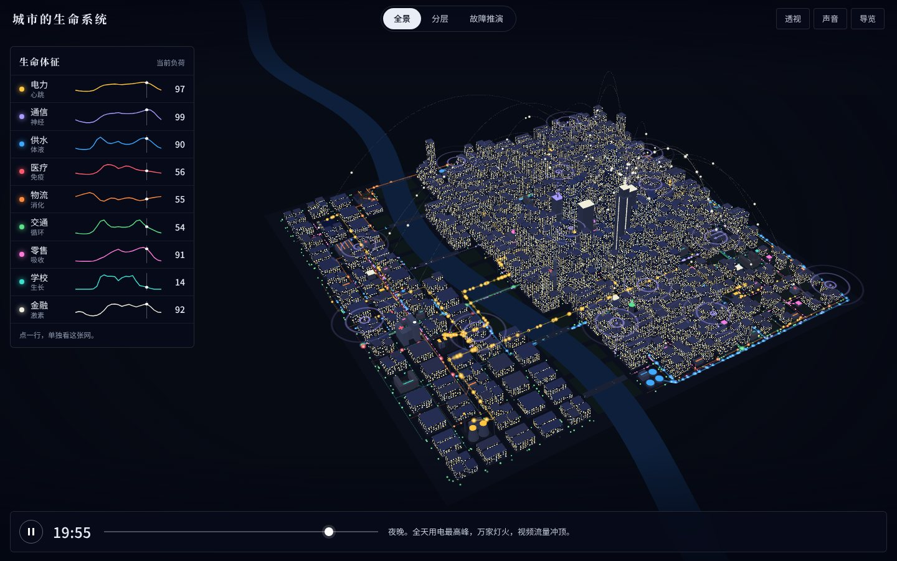
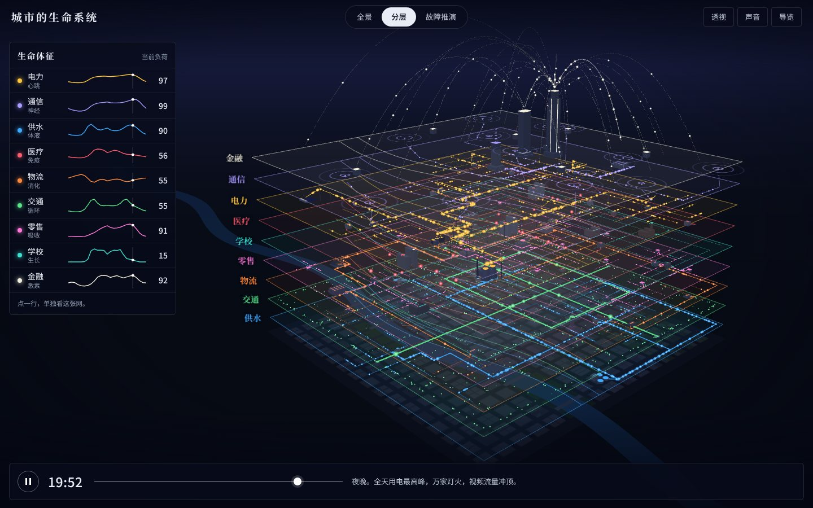
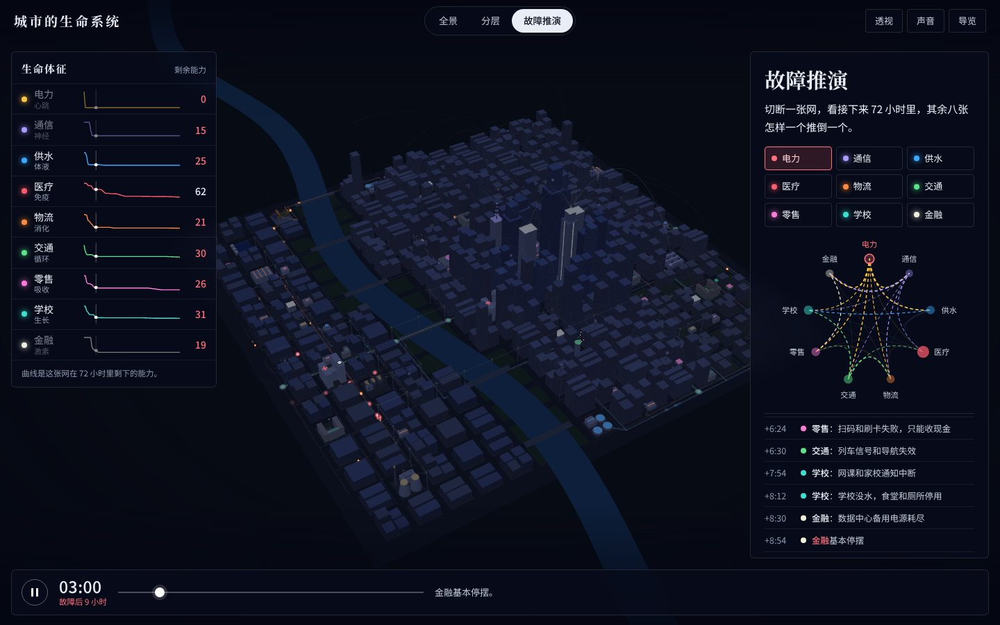

# 城市的生命系统

电力、通信、供水、医疗、物流、交通、零售、学校、支付与金融：九张网怎样让一座城市活着。一个可以转动、拨时间、拆开看、还能动手切断的三维城市。

**在线体验：<https://wanglu2016.github.io/chengshi-shengming-xitong/>**



## 能做什么

| | |
|---|---|
| **看一天** | 底部的时间条可以拖动或自动播放。昼夜会变，九张网各有各的节律：物流在凌晨最忙，学校只在早八点和下午四点涌动，用电在晚上七八点冲顶。 |
| **看一张网** | 点左侧“生命体征”里的任一行，楼房变透明，只留下这张网的管线、设施和流动。右侧说明它怎么运转、靠谁、谁靠它。 |
| **跟着走一趟** | 每张网都有一段跟随镜头：跟一度电进城、跟一滴水走完一圈、跟一个包裹、一辆急救车、一笔支付…… |
| **分层** | 把九张网从同一块地面上一层层揭开，像解剖图。 |
| **故障推演** | 切断任何一张网，把时间拨快，看 72 小时里其余八张怎样一个推倒一个：先是地铁，然后是高楼的水，四小时后是基站，接着是支付。 |
| **导览** | 十三步，带你把上面的都走一遍。 |





## 怎么操作

- 电脑：拖动旋转，滚轮缩放，按住 Shift 拖动平移；方向键转动视角，`+` `-` 缩放，`Esc` 退出当前状态。
- 手机：单指拖动旋转，双指缩放和平移。
- 右上角“透视”可以随时把楼房变透明；“声音”是一段跟着城市负荷变化的心跳，故障时会变慢、变乱。
- 点设施上方的标记，可以看它是什么、做什么用。

## 下载离线版

[chengshi-shengming-xitong-site.zip](https://github.com/wanglu2016/chengshi-shengming-xitong/raw/main/download/chengshi-shengming-xitong-site.zip)（约 1.6 MB）

解压后双击 `index.html` 就能用，不需要联网，也不需要安装任何东西。

## 注意事项

- **这是一座虚构的城市。** 街区、设施位置、负荷曲线、依赖强度和储备时长都是为了讲清楚道理而设的示意值，不是任何真实城市的实测数据，不能用来做工程或应急决策。
- 故障推演是一个很简单的模型：每条依赖有一个强度和一段储备时间，储备耗尽后影响按强度向下游传导。真实世界里还有抢修、调度、替代方案和人的应变，这里都没有算。
- 需要浏览器支持 WebGL。很旧的手机上可能会卡。
- 尊重系统的“减少动态效果”设置：打开后不会自动旋转和自动播放，镜头直接切换。

## 素材与许可

| 内容 | 来源 | 许可 |
|---|---|---|
| 城市、管线、设施模型 | 本项目用代码程序生成（`assets/js/world.js`） | 随本仓库 |
| 文案、负荷曲线、依赖关系 | 本项目编写的示意数据（`assets/js/data.js`） | 随本仓库 |
| three.js r160 | <https://threejs.org> | MIT，见 `assets/js/three.LICENSE.txt` |
| Noto Sans SC / Noto Serif SC（按用字裁剪） | <https://github.com/notofonts/noto-cjk> | SIL OFL 1.1，见 `assets/fonts/OFL.txt` |

## 目录结构

```
index.html              页面
assets/
  css/style.css         样式
  css/fonts.css         字体声明
  fonts/                裁剪后的中文字体与许可
  img/                  截图、分享图、图标
  js/three.min.js       three.js
  js/data.js            九个系统的文案、节律曲线、依赖关系、导览脚本
  js/sim.js             故障连锁的计算
  js/world.js           生成城市和九张网，负责三维绘制
  js/app.js             界面、镜头、时间、导览、声音
download/               离线包
tools/                  字体裁剪脚本
使用说明.txt             离线包里的说明
```

想改内容的话，绝大多数只需要动 `assets/js/data.js`：系统的名字和说明、24 小时曲线、设施的名字和位置、每一条依赖的强度与储备时间、导览的每一步，都在里面。

## 本地运行

没有构建步骤。直接双击 `index.html`，或者起一个静态服务器：

```bash
python3 -m http.server 8000
# 然后打开 http://localhost:8000
```
